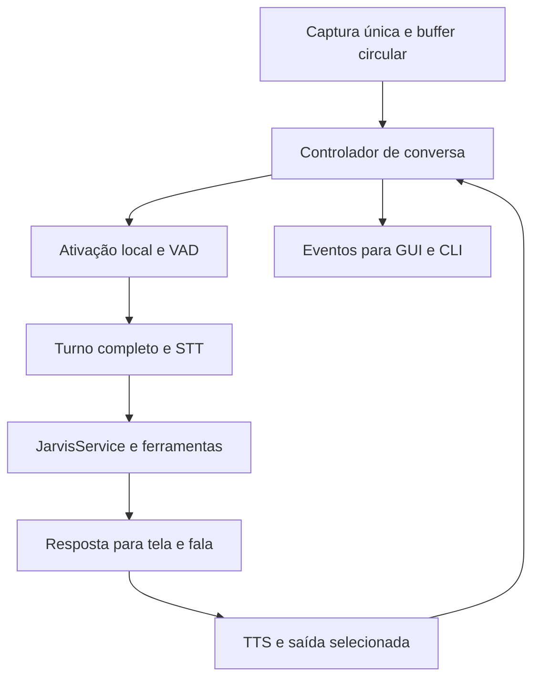

# Plano executável: conversa por voz e autonomia

Estado: **planejamento proposto para orientar implementação; funcionalidades abaixo ainda não implementadas por este documento**. Base funcional publicada: `127cfed57bd3557bce6d8a838034e51291a09ad6`. Data: 23/10/2026.

## Resultado esperado

Ao iniciar `jarvis-fcc`, texto e voz compartilham uma sessão. Na GUI, a tela inicial mostra conversa, estado, microfone, parar e configurações. Bryan diz “Jarvis, abra o Firefox e organize minhas janelas”, continua falando pelo tempo necessário, termina e recebe uma resposta falada breve sobre o efeito realmente verificado. Aproximadamente um segundo de silêncio encerra o turno; não existe janela obrigatória de seis segundos. Um botão de falar continua disponível como alternativa, usando o mesmo detector de fim de fala.

Voz “própria” significa uma voz local pt-BR selecionada, consistente e configurada dentro do produto, com estilo de resposta coerente. Não exige clonagem de voz. Autonomia significa compreender intenção, escolher e executar ferramentas autorizadas, observar o resultado e retomar a conversa; não criar tarefas recorrentes ou agir sem objetivo fornecido pelo usuário.

## Contratos de arquitetura

O diagrama expressa responsabilidade, não exige criar uma thread para cada caixa. Não conectar saída de áudio de volta à transcrição como se fosse voz do usuário.

Estado canônico: `iniciando → aguardando_ativacao → ouvindo → transcrevendo → executando → falando → aguardando_seguimento`. Também existem `mudo`, `cancelado`, `recuperando_audio` e `erro`. Em seguimento, nova fala dispensa “Jarvis”; a janela de inatividade é configurável e reinicia por atividade, nunca corta uma fala já iniciada. Toda transição carrega `session_id`, `turn_id` e motivo. GUI e CLI apenas apresentam estados/eventos e submetem intenções.

Estrutura sugerida, adaptável por decisão registrada:

| Módulo | Responsabilidade |
| --- | --- |
| `audio/capture.py`, `audio/devices.py` | Dono da captura, negociação de formato, roteamento, reconexão, filas e métricas de quadros |
| `audio/wake.py`, `audio/endpoint.py` | Detector de palavra e segmentação por VAD/silêncio; sem FCC nem widgets |
| `conversation/controller.py`, `conversation/events.py` | Estados, turnos, cancelamento, exclusão de áudio e ligação com serviço |
| `speech_text.py`, `persona.py` | Texto falável, política de estilo e separação entre fala e apresentação visual |
| `preferences.py` | Preferências versionadas/validadas, gravação atômica, migração e precedência de ambiente |
| `voice.py`, `voice_session.py` | Adaptadores compatíveis durante a migração; eliminar fluxos duplicados progressivamente |
| `gui_shell.py`, `gui_voice.py`, `gui_models.py` | Tela de conversa e configurações; sem regra de execução local nos widgets |

Não criar abstrações vazias apenas para reproduzir a árvore. Extrair cada responsabilidade quando houver uma implementação e seus consumidores.

## Etapa 0 — reproduzir e medir antes de alterar

1. Atualizar `main`, preservar trabalho alheio, ler `AGENTS.md` e a revisão de referências. Registrar SHAs reais de partida.
2. Mapear startup, flags, conexão FCC, início da escuta, áudio recebido, VAD, transcrição, ativação, pedido aceito/rejeitado, TTS e saída.
3. Reproduzir separadamente botão de seis segundos, modo contínuo e CLI mista. Identificar exatamente qual estado/etapa falha no fone. Uma chamada HTTP 404 após transcrição é falha de provedor, não ausência de áudio.
4. Registrar configuração efetiva sem tokens: backend, fonte, saída, taxa/canais, modelo STT, modo de ativação, modelo de conversa e saúde TTS. Medir baseline de CPU, RSS e tempos por etapa.
5. Criar `docs/VALIDACAO_CONVERSA.md`, com estados **passou**, **falhou**, **pendente** e evidência. A suíte de checkpoint anterior registrou 370 testes, um ignorado com display virtual; reexecutar e registrar a contagem atual, sem copiá-la como novo resultado.

Saída: diagnóstico reproduzível e prioridades. Não esperar todas as credenciais para corrigir lifecycle, fila e UI; ensaio físico continua explicitamente pendente onde necessário.

## Etapa 1 — sessão unificada e captura confiável

1. Introduzir controlador único usado por GUI/CLI; manter serviço e lock existentes. Separar inicialização de áudio da disponibilidade do modelo FCC: falha de rede não pode deixar diagnóstico e estado do microfone invisíveis.
2. Um stream entrega quadros com timestamp monotônico. Callback só copia/enfileira; VAD, STT e subprocessos ficam fora dele e fora da thread Tk.
3. Implementar buffer circular de pré-fala de 0,5–1 s, controle explícito de overflow e teste de continuidade. Se faltar áudio, sinalizar turno inválido; não executar texto que pode ter perdido informação.
4. Negociar formato suportado pelo Bluetooth e ressamplar uma vez para o formato do detector/STT. Confirmar a fonte efetiva: nome SoundDevice, fonte PipeWire/Pulse e monitor de saída não são equivalentes.
5. Desconexão deve encerrar/recuperar o stream com retentativas limitadas e backoff; preservar texto. Mudo, troca de entrada e fechamento liberam o dispositivo. Não mudar a entrada global do sistema como efeito oculto.

Aceite: uma captura por sessão; sem deadlock em pausar/retomar/trocar entrada; overflow visível; reconexão não duplica listener. Testes com backend falso de frames e ensaio Bluetooth separados.

## Etapa 2 — acabar com o corte por cronômetro

1. Unificar botão e contínuo em `start_turn/end_turn`. O botão inicia escuta e finaliza por VAD/silêncio ou segundo clique explícito; não chama `record(6)` para pedidos normais. Gravação fixa pode permanecer exclusivamente no diagnóstico com rótulo claro.
2. Usar VAD calibrável; RMS permanece métrica de nível, não única prova de fala. Medir ruído ambiente sem calibrar por cima da própria fala.
3. Começar com silêncio de fim de turno de 1.000 ms, ajustável entre 600–1.800 ms nas configurações avançadas. Uma pausa de 800 ms não deve enviar o pedido nessa configuração.
4. Separar timeout para começar a falar, janela de seguimento e tamanho de chunk. Inatividade só vence antes de fala começar. Os atuais tetos de 15/20 s não podem finalizar uma frase ativa silenciosamente.
5. Para áudio longo, segmentar internamente com sobreposição e remontagem sem duplicações. Só enviar a intenção consolidada no endpoint. Um teto emergencial configurável, por exemplo 120 s, deve avisar e manter o turno pendente, sem executar a versão cortada. Não armazenar um buffer ilimitado em RAM.
6. Terminador verbal opcional deve ser uma expressão configurada e reconhecida no contexto de controle, não retirar palavras comuns de um pedido ditado. “Parar conversa” encerra a sessão sem disparar ferramentas.
7. Avaliar VAD e indicadores do STT sobre ruído, silêncio e fala incompleta. Similaridade textual com uma frase de teste não é confiança de uma transcrição livre. Não criar uma blacklist de “obrigado” ou outras falas legítimas para mascarar alucinações; pedir repetição breve quando não houver uma intenção confiável para executar.

Aceite: pedidos de 3, 10, 25 e 60 s completos; pausas internas curtas preservadas; silêncio/ruído não executam comandos; término manual sem duplicar envio; limite emergencial nunca executa frase parcial.

## Etapa 3 — ativação real por “Jarvis”

1. Definir `WakeWordEngine` com eventos próprios. Avaliar detector local leve no áudio contínuo, mantendo Whisper small para o comando completo e um único cache de modelo.
2. O `hey_jarvis` examinado no Mark é apenas candidato para avaliação. Testar **Jarvis isolado**, com pronúncia pt-BR. Se não satisfizer, validar/adaptar modelo próprio ou outro detector local. Registrar artefato, licença, hash e requisitos. Não anunciar suporte sem modelo pronto.
3. Não tratar treinamento personalizado como dependência invisível. Se faltar um artefato validado, registrar esse bloqueio e um fallback local claramente identificado; não trocar o requisito para “Hey Jarvis”.
4. Preservar áudio do buffer para não perder o pedido após a chamada; confirmação visual e sonora curta de ativação, sem uma saudação longa que fale por cima do usuário.
5. Calibrar limiar, cooldown e negativos. Informar detector indisponível, microfone mudo e modelo carregando como estados diferentes. Depois da resposta, retomar seguimento sem nova ativação até expirar a inatividade.

Aceite físico proposto: pelo menos 18 ativações em 20 chamadas “Jarvis” no fone real, mais sessão negativa de 30 min com no máximo uma falsa ativação. Repetir com ruído e distâncias registradas. É um gate de amostra, não garantia estatística universal. Sem esse ensaio, a entrega de wake word permanece pendente.

## Etapa 4 — voz padrão e personalidade utilizável

1. Criar setup acessível em Configurações: escolher saída, instalar/selecionar voz local pt-BR, reproduzir frase de teste e salvar preferências. Piper com `pt_BR-faber-medium` é ponto de partida já documentado; verificar compatibilidade dos artefatos e licenças da voz antes de distribuir.
2. O fluxo normal não deve exigir exportar variáveis no terminal. Downloads precisam de origem conhecida, progresso, verificação disponível e erro recuperável. Não instalar pacotes do sistema sem necessidade nem bloquear startup com download.
3. Carregar voz uma vez; separar síntese e reprodução. Usar saída selecionada, também para Bluetooth, com timeout, cancelamento e limpeza. Uma falha de TTS mantém a resposta visual e oferece testar novamente, sem fingir que falou.
4. Criar representação `display_text/spoken_text`. Converter Markdown preservando o significado: ênfase vira texto, links usam rótulos, código/tabelas recebem resumo adequado. Não remover indiscriminadamente asteriscos de matemática nem falar URLs/JSON por padrão. Eliminar o corte `text[:3000]`; segmentar por frases e respeitar a ordem.
5. Persona: pt-BR, frases curtas, cordialidade discreta, sem repetir “Olá Bryan”, sem narrar “asterisco”, sem perguntar “posso ajudar?” ao terminar cada resposta. Fala não deve ser uma segunda inferência obrigatória para toda resposta: preferir instruções de estilo e formatação determinística.
6. Toda voz usa a mesma verificação de resultado. Exemplo após ação confirmada: “Pronto. Deixei as duas janelas lado a lado.” Se só abriu Firefox: “Abri o Firefox. Não consegui confirmar a posição das janelas.” Não afirmar sucesso por ter enviado o comando.

Aceite: abrir a aplicação configurada, dizer uma pergunta, ouvir a resposta e continuar sem teclado. Testes de áudio audível, TTS ausente, voz inválida, saída errada, queda do player, texto longo, código e Markdown. Configuração inicial e reinício preservam preferências; variáveis explícitas de ambiente têm precedência documentada.

## Etapa 5 — autonomia da intenção ao efeito

1. Auditar como `JarvisService.ask`, roteador, agente e planejador tratam pedidos de ação. Reusar Toolkit, registro, loop guard e cancelamento. Não construir outro executor dentro da cadeia de voz.
2. Pedidos inequívocos de abrir aplicativo, manipular abas gerenciadas ou organizar janelas devem executar e verificar. Perguntas gerais respondem sem ferramentas desnecessárias. Pedidos compostos geram/acompanhham plano quando necessário.
3. Não fazer pergunta de cortesia antes de cada ação autorizada. Perguntar somente por ambiguidade material, transcrição incerta que altere o efeito, dado ausente ou aprovação realmente exigida.
4. Registrar correlação entre áudio, intenção, ferramentas e efeito; sem áudio bruto ou transcrição ambiental persistidos por padrão. Nunca repetir uma ação com efeitos só para conseguir uma segunda resposta do modelo.
5. Saúde de modelo separada do catálogo: HTTP 404 NIM gera orientação e seleção persistente de alternativa disponível. Respeitar política existente de fallback/provedor; não reenviar ferramentas já executadas em fallback de resposta.

Aceite: “abra Firefox”, “adicione revisar relatório às minhas tarefas” e “coloque Firefox e VS Code lado a lado” resultam em efeitos observados, respeitando diferenças entre navegador gerenciado e Firefox pessoal. Alvo ausente, título ambíguo, permissões GNOME e 404 não viram alegação de sucesso. Testar correção de um pedido sem duplicar a ação anterior.

## Etapa 6 — interface de conversa inspirada no Mark

1. Início limpo: HUD discreto, estado legível, conversa/transcrição, campo de texto, microfone/mudo, Parar e engrenagem. Não manter dez painéis operacionais fixos.
2. Configurações recolhidas com Voz, Microfone, Modelo de conversa, Diagnósticos e Avançado. Planos/tarefas/janelas podem aparecer por atalho ou quando relevantes ao pedido, sem perder funções existentes.
3. Mostrar exatamente “Aguardando Jarvis”, “Ouvindo”, “Entendendo”, “Executando”, “Falando”, “Mudo”, “Sem microfone” ou erro de IA. Não usar “Pronto” como substituto de um erro não resolvido.
4. Preferências persistentes para modo, voz, modelo STT, entrada e saída; seleção do modelo de conversa também sobrevive ao reinício. Não persistir segredos junto delas. Entrada desconectada exibe estado e alternativa explicitamente.
5. Validar 1040×640 e 1366×768, fonte real do GNOME e escala maior. Configurações precisam de rolagem quando necessário; nenhum botão essencial pode desaparecer fora da janela.

Aceite: em um teste guiado, abrir, configurar voz uma vez, chamar Jarvis e concluir uma ação sem navegar por diagnósticos. Screenshots simulados validam layout; não provam captura nem TTS.

## Etapa 7 — eco, interrupção e recuperação

Primeiro entregar conversa sequencial: captura normal protegida durante TTS, botão Parar imediato e retorno garantido à escuta. Depois implementar interrupção por voz com detecção dedicada e controle de eco, sem reintroduzir streams concorrentes. Não confundir wake word enquanto mudo ou ouvindo com barge-in durante reprodução.

Aceite adicional: Jarvis não responde à própria voz; parar cancela síntese/reprodução e descarta chunks/resultados atrasados; nova fala não herda um comando antigo. Barge-in só é anunciado após ensaio com fone e alto-falantes. Um bloqueio físico deve ficar explícito e não impedir a publicação das demais melhorias testadas.

## Matriz mínima de validação

| Jornada | Automação | Ensaio real necessário |
| --- | --- | --- |
| Jarvis isolado + pedido na mesma frase | Fixtures de áudio consentidas e eventos de detector | Fone Bluetooth, 20 chamadas e negativos |
| Fala longa e pausa de 0,8 s | Frames contínuos, endpoint e texto consolidado | Pedido de pelo menos 25 s |
| Silêncio/ruído/overflow | Nenhum pedido executado, motivo visível | Ambiente real e desconexão |
| Modelo indisponível | 404 separado de áudio; sem replay de efeitos | Inferência com modelo configurado disponível |
| Resposta falada natural | Formatter, ordem dos chunks, cache e cancelamento | Saída audível, pt-BR, sem Markdown narrado |
| Ação autônoma | Ferramenta real ou adaptador controlado com estado verificável | Firefox/VS Code e GNOME Wayland |
| Reinício, reconexão, mudo e parar | Lifecycle e preferências | Reconectar fone e reabrir aplicação |
| UI simples e acessível | Bounds/foco com display virtual | GNOME do notebook, resolução e escala reais |

Instrumentação: tempos monotônicos de ativação, início/fim de fala, STT, FCC, ferramentas, primeiro áudio e fim de reprodução; CPU/RSS, quadros perdidos, tamanho das filas, ativações/falsos positivos. Não somar download/carga inicial à latência aquecida sem identificar a diferença.

Metas iniciais a verificar no notebook: endpoint em torno de 1 s (p95 até 1,5 s em silêncio limpo), sem truncamentos nos testes longos; primeiro áudio em até 2 s após texto disponível com TTS aquecido; nenhum crescimento contínuo de RSS/filas após 30 turnos. Latência de STT e FCC deve ser medida separadamente e comparada ao baseline; não prometer tempo de nuvem que o aplicativo não controla.

## Ordem de entrega e encerramento

Dependência principal: 0 → 1 → 2 → 3; 4 depende de 1 e pode preceder o aceite final de 3; 5 integra a cadeia; 6 consolida os fluxos já estáveis; 7 valida eco e interrupção. Dividir cada etapa em commits menores testados, publicando em `main` conforme autorização do usuário. Uma sessão de trabalho pode percorrer todas as etapas, com checkpoints, sem um commit gigantesco.

Cada entrega informa comportamento implementado, teste realizado, pendência física e próxima dependência. O encerramento exige demonstrar a jornada acordada, não apenas aumentar o contador de testes. Se o ambiente do agente não acessa Bluetooth/Piper/FCC reais, entregar implementação e roteiro exato de validação, deixando o gate correspondente pendente. Não declarar a versão final aceita nesse caso.
