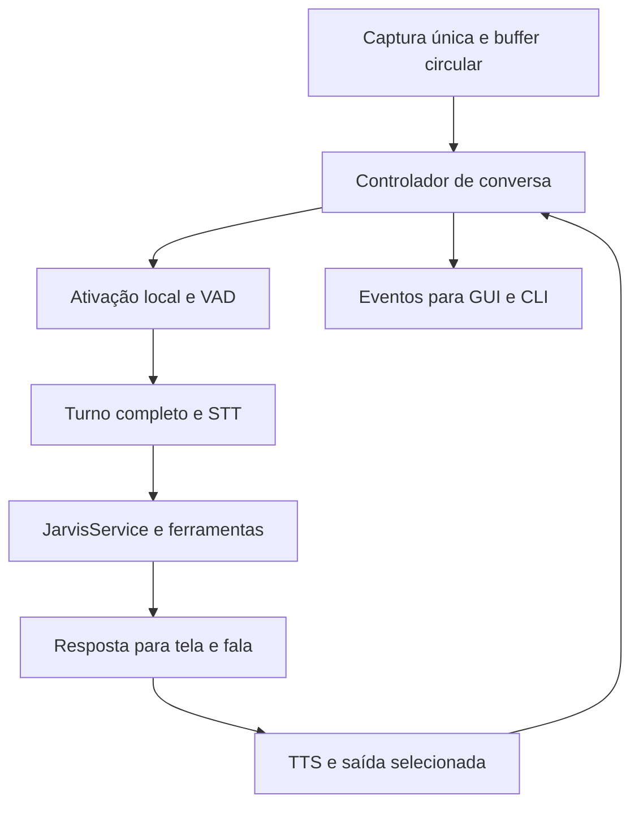

# Prompt único — free-jarvis autônomo, com voz e interface simples

Você é o engenheiro sênior responsável por evoluir `Bryan9895/free-jarvis` até uma experiência de conversa e execução autônoma utilizável. Trabalhe no repositório existente, com implementação, testes e publicação incremental. O usuário já autorizou enviar cada alteração concluída à branch `main`, mesmo pequena; não peça novamente essa autorização. Preserve trabalho alheio e não faça force push.

Esta é uma especificação única: incorpora diagnóstico, comparação de referências, regras para o agente, arquitetura, plano e critérios de aceite. Não depende da leitura dos quatro documentos que a originaram. Leia as instruções aplicáveis do repositório e o código real antes de alterar qualquer implementação; confronte os snapshots abaixo com a versão atual.

Comece auditando o `AGENTS.md` existente. Atualize-o, sem apagar instruções válidas, para refletir as regras deste prompt. Depois execute o plano em etapas pequenas. Não pare somente na elaboração de novos documentos: implemente, verifique e publique o que for executável no ambiente, registrando os aceites físicos pendentes.

As funcionalidades propostas aqui são trabalho futuro, não resultados já demonstrados. Preserve o histórico e não declare o projeto concluído antes da jornada de aceite.

## 1. Missão e experiência final

Ao iniciar `jarvis-fcc`, texto e voz compartilham uma sessão. Na GUI, a tela inicial mostra conversa, estado, microfone, parar e configurações. Bryan diz “Jarvis, abra o Firefox e organize minhas janelas”, continua falando pelo tempo necessário, termina e recebe uma resposta falada breve sobre o efeito realmente verificado. Aproximadamente um segundo de silêncio encerra o turno; não existe janela obrigatória de seis segundos. Um botão de falar continua disponível como alternativa, usando o mesmo detector de fim de fala.

Voz “própria” significa uma voz local pt-BR selecionada, consistente e configurada dentro do produto, com estilo de resposta coerente. Não exige clonagem de voz. Autonomia significa compreender intenção, escolher e executar ferramentas autorizadas, observar o resultado e retomar a conversa; não criar tarefas recorrentes ou agir sem objetivo fornecido pelo usuário.

## 2. Referências, funções e diagnóstico atual

O nome “MarkIV” usado na conversa corresponde à referência anteriormente indicada, **FatihMakes/Mark-LVI**. OpenJarvis é **open-jarvis/OpenJarvis**, não projetos homônimos de outros autores.

| Projeto | Snapshot examinado | Arquivos principais examinados |
| --- | --- | --- |
| [Mark-LVI](https://github.com/FatihMakes/Mark-LVI) | `4d4035c1b40a3bc796ac63f2f1b6a99bc0dd334d` | `readme.md`, `ui.py`, `main.py`, `core/wake_word.py`, `core/echo.py`, `providers/engine_pipeline.py`, `providers/tts_piper.py` |
| [OpenJarvis](https://github.com/open-jarvis/OpenJarvis) | `4741d5d38875de0ea4e266e5daa1151e8f4a44c2` | `src/openjarvis/speech/voice_io.py`, `speech/tts.py`, `speech/_stubs.py`, `agents/tool_resolver.py`, `agents/loop_guard.py`, `core/events.py`, `LICENSE` |
| free-jarvis | publicado `127cfed57bd3557bce6d8a838034e51291a09ad6` | `voice.py`, `voice_session.py`, `gui.py`, `gui_voice.py`, `gui_models.py`, `service.py`, `agent.py`, `loop_guard.py`, `config.py` |

### O que as referências oferecem e como aproveitar

| Área | Evidência | Aplicação proposta no free-jarvis |
| --- | --- | --- |
| Ativação | Mark tem `WakeWordDetector`, fila limitada e inferência fora do callback. Seu modelo é `hey_jarvis`, não uma prova de reconhecimento de “Jarvis” isolado em pt-BR. | Detector dedicado, separado de STT, com medição real da palavra exigida. Nunca mudar silenciosamente o requisito para “Hey Jarvis”. |
| Fim de fala | Pipeline local do Mark acumula áudio e mede silêncio com piso adaptativo. `OpenJarvis/speech/voice_io.py` grava até silêncio; o snapshot usa 1,5 s e teto de 30 s. | Coordenador único com VAD e silêncio configurável de aproximadamente 1 s. Não copiar os tetos como duração de pedido. |
| Resposta falada | Mark separa STT/LLM/TTS e tem Piper, voz do sistema e outros provedores. OpenJarvis define contratos separados para síntese, resultado e health check. | Contrato de TTS com instalação/seleção/teste visíveis, reprodução na saída escolhida e erros próprios. Voz local como caminho principal. |
| Eco e interrupção | Mark tem `EchoGuard`. O próprio comentário diz que interrupção por voz depende de ensaio físico e permanece desligada nesse caminho. | Priorizar ausência de autoativação e botão Parar; barge-in é uma fase com evidência acústica, não funcionalidade garantida por existir uma classe. |
| Interface | Mark usa HUD e configurações em drawer. | Tela inicial centrada na conversa e controles essenciais; opções raras em uma área recolhida. Sem copiar assets ou adotar PyQt6 apenas por semelhança. |
| Execução | OpenJarvis separa resolução de ferramentas, eventos e proteção contra loops. | Evoluir o núcleo já existente, correlacionar turnos/ações e verificar efeitos. Não recriar registro/loop guard que o free-jarvis já tem. |

As referências mostram padrões úteis, não comprovam operação perfeita em Wayland, em português ou com o fone do usuário. OpenJarvis é um framework amplo; sua existência não implica wake word pronta neste caminho de captura.

### Diagnóstico do free-jarvis

| Problema | Evidência no código ou no relato | Consequência |
| --- | --- | --- |
| Pedido limitado a 6 s no botão | `gui.py`, ação `voice_push_to_talk`, chama `voice.record(6)`. `VoiceIO.record` também tem padrão 6. | Frase pode terminar fora da janela e ser enviada incompleta. |
| Ativação frágil | `WakeWordConversation` transcreve uma fala completa e depois aplica `WAKE_PATTERN` no começo do texto. | Precisão e latência do Whisper também controlam a ativação; não há detector acústico dedicado. |
| Contínuo já existe, mas não foi aceito fisicamente | `_listen_for_command` usa RMS e 1 s de silêncio. O usuário relata que não ativa. | A correção exige reproduzir a sessão e medir a cadeia, não afirmar que basta ativar o botão. |
| Outro limite pode cortar uma fala longa | `max_command_seconds=15`; `idle_timeout=20` durante seguimento é contado desde a abertura da captura, inclusive após começar a falar. | Mesmo fora do botão, turnos longos podem ser interrompidos. Timeout de espera e limite de armazenamento estão misturados. |
| Quadros podem ser descartados | A fila de `_listen_for_command` remove o item mais antigo quando enche. | Pressão de CPU pode perder trechos sem um erro explícito para o usuário. |
| Microfone Bluetooth/roteamento | Captura força mono 16 kHz; seleção SoundDevice e `PULSE_SOURCE` são camadas diferentes. | É preciso negociar formato/ressample e confirmar a fonte real. Uma entrada disponível não comprova fala chegando. |
| TTS opcional sem configuração fácil | `VoiceIO.speak` retorna `disabled` sem `JARVIS_PIPER_MODEL`; exige arquivo, `piper` e `aplay`. | Ter o pacote instalado não significa ter voz funcionando. |
| Texto visual enviado diretamente à voz | GUI encaminha a resposta a `speak`; não há representação própria para fala. Há ainda `text[:3000]` na síntese. | Markdown pode ser pronunciado e respostas longas são truncadas. Falta personalidade de conversa e segmentação sem cortes arbitrários. |
| Erro da IA confundido com áudio | Imagem do usuário contém fala recebida e 404 upstream NIM, função não encontrada para a conta. | Captura, transcrição e resposta precisam de estados independentes. Uma troca de Whisper não corrige NIM. |
| Interface expõe operação demais | Menu lateral mantém planos, tarefas, abas, janelas, permissões, ambientes, histórico, métricas, modelos e voz permanentemente. | A navegação continua orientada a administração, em vez de conversa. |

## 3. Regras obrigatórias para o agente e para o AGENTS.md

1. Preserve `JarvisService`, FCC, SQLite, `Toolkit`, registro de ferramentas e integrações GNOME. Evolua os adaptadores; evite reescrever o produto inteiro.
2. GUI e CLI devem usar o mesmo controlador de conversa. Widgets não abrem microfone, não chamam FCC diretamente e não executam ferramentas.
3. Uma sessão possui um único dono do dispositivo de captura. Wake word, VAD e diagnóstico recebem áudio pelo coordenador, sem streams concorrentes nem perda silenciosa de quadros.
4. Detecção de ativação, fim de fala, STT, execução e TTS são etapas distintas. Modelo de conversa não é modelo Whisper; nível de áudio não comprova fala compreendida.
5. Não use seis segundos como duração obrigatória de pedido. Um limite técnico de buffer pode segmentar o áudio, mas não finalizar/truncar a intenção sem informar o usuário.
6. “Jarvis” isolado é requisito. Um modelo que só detecta “Hey Jarvis” não satisfaz esse requisito. Valide pronúncia brasileira e documente disponibilidade do detector antes de anunciá-lo como ativo.
7. Controle transições com IDs de sessão/turno, eventos tipados e cancelamento. Ignore resultados atrasados de turnos cancelados; não duplique comandos nem confirmações.
8. Texto para tela e texto para voz são representações distintas. Não leia Markdown, caminhos extensos, JSON ou blocos de código literalmente como resposta comum.
9. Use carregamento tardio/cache limitado para STT/TTS. O alvo tem 8 GB de RAM, CPU e Bluetooth; não exija GPU, nuvem de áudio ou múltiplos modelos Whisper carregados.
10. Falhas de microfone, STT, modelo FCC e saída de áudio precisam ter estados e recuperação independentes. Não confunda 404 NIM com falha de escuta.

### Autonomia e comportamento

- Execute instruções claras pelas ferramentas existentes, sem substituir a ação por um tutorial. Faça perguntas apenas quando faltar uma informação que muda a ação.
- Preserve autorizações existentes e permissões nativas. Autonomia não é afirmar efeitos sem observá-los nem contornar permissões do desktop.
- Só diga “concluído” com evidência de resultado; diferencie pedido enviado, efeito verificado e efeito incerto. Preserve cancelamento, loop guard e histórico.
- Não repita ações com efeitos após falha de rede sem saber se já aconteceram. Fallback de provedor segue a política configurada e fica visível.
- Personalidade: direta, calma, cordial, competente, sem saudações repetidas, uso insistente do nome Bryan ou narração de símbolos. Nunca invente estados de humor, consciência ou acesso que não existem.

### Interface

- Início: indicador de estado real, transcrição/conversa, campo de texto, microfone/mudo, parar e acesso a configurações.
- Configurações: Voz, Microfone, Modelo de conversa, Diagnósticos e Avançado. Tarefas, planos, janelas e métricas continuam acessíveis, sem ocupar permanentemente a tela inicial.
- Sem animação que finja captura ou execução; forma de onda, se existir, usa medidas reais.
- Preserve Tkinter inicialmente. Registre uma decisão com custos e protótipo validado antes de qualquer migração de toolkit.

### Verificação e entrega

- Rode a suíte adequada à mudança: `PYTHONPATH=src python -m unittest discover -s tests -q`; use display real/virtual para mudanças de GUI, além de `git diff --check`.
- Teste jornadas completas e erros, além dos componentes. Registre separadamente: teste automatizado, ensaio com áudio gravado e ensaio físico Bluetooth/FCC/GNOME.
- Registre latência por etapa, taxa de ativações corretas e falsos positivos. Metas no plano são critérios futuros, nunca resultados já medidos.
- Sem áudio/transcrições ambientais em logs persistentes por padrão. Dados de avaliação consentidos ficam fora do git; métricas sanitizadas podem ser versionadas.
- Ao faltar hardware/credencial, implemente e valide o que for possível e mantenha o aceite físico explicitamente pendente. Não invente uma validação.

### Git e referências

- O usuário autorizou publicar cada alteração concluída na branch **main**, inclusive pequena. Faça commits pequenos, verificáveis, sem pedir novamente autorização para esse envio.
- Confira o remoto antes de publicar; preserve alterações alheias. Não faça force push. Use a integração GitHub quando push por shell não estiver disponível.
- Mark-LVI: referência de experiência/arquitetura sob CC BY-NC 4.0. Escreva código e assets próprios; não importe seu avatar, identidade, arquivos ou implementação.
- OpenJarvis: referência modular sob Apache-2.0. Não adicione seu framework inteiro como dependência para copiar uma abstração; eventual reutilização de código exige os avisos aplicáveis.
- Não instale dependências das referências nem execute seus scripts de setup só para analisá-las.

## 4. Arquitetura e plano de execução

O diagrama expressa responsabilidade, não exige criar uma thread para cada caixa. Não conectar saída de áudio de volta à transcrição como se fosse voz do usuário.

Estado canônico: `iniciando → aguardando_ativacao → ouvindo → transcrevendo → executando → falando → aguardando_seguimento`. Também existem `mudo`, `cancelado`, `recuperando_audio` e `erro`. Em seguimento, nova fala dispensa “Jarvis”; a janela de inatividade é configurável e reinicia por atividade, nunca corta uma fala já iniciada. Toda transição carrega `session_id`, `turn_id` e motivo. GUI e CLI apenas apresentam estados/eventos e submetem intenções.

Estrutura sugerida, adaptável por decisão registrada:

| Módulo | Responsabilidade |
| --- | --- |
| `audio/capture.py`, `audio/devices.py` | Dono da captura, negociação de formato, roteamento, reconexão, filas e métricas de quadros |
| `audio/wake.py`, `audio/endpoint.py` | Detector de palavra e segmentação por VAD/silêncio; sem FCC nem widgets |
| `conversation/controller.py`, `conversation/events.py` | Estados, turnos, cancelamento, exclusão de áudio e ligação com serviço |
| `speech_text.py`, `persona.py` | Texto falável, política de estilo e separação entre fala e apresentação visual |
| `preferences.py` | Preferências versionadas/validadas, gravação atômica, migração e precedência de ambiente |
| `voice.py`, `voice_session.py` | Adaptadores compatíveis durante a migração; eliminar fluxos duplicados progressivamente |
| `gui_shell.py`, `gui_voice.py`, `gui_models.py` | Tela de conversa e configurações; sem regra de execução local nos widgets |

Não criar abstrações vazias apenas para reproduzir a árvore. Extrair cada responsabilidade quando houver uma implementação e seus consumidores.

### Etapa 0 — reproduzir e medir antes de alterar

1. Atualizar `main`, preservar trabalho alheio, ler `AGENTS.md` e a análise incorporada neste prompt. Registrar SHAs reais de partida.
2. Mapear startup, flags, conexão FCC, início da escuta, áudio recebido, VAD, transcrição, ativação, pedido aceito/rejeitado, TTS e saída.
3. Reproduzir separadamente botão de seis segundos, modo contínuo e CLI mista. Identificar exatamente qual estado/etapa falha no fone. Uma chamada HTTP 404 após transcrição é falha de provedor, não ausência de áudio.
4. Registrar configuração efetiva sem tokens: backend, fonte, saída, taxa/canais, modelo STT, modo de ativação, modelo de conversa e saúde TTS. Medir baseline de CPU, RSS e tempos por etapa.
5. Criar `docs/VALIDACAO_CONVERSA.md`, com estados **passou**, **falhou**, **pendente** e evidência. A suíte de checkpoint anterior registrou 370 testes, um ignorado com display virtual; reexecutar e registrar a contagem atual, sem copiá-la como novo resultado.

Saída: diagnóstico reproduzível e prioridades. Não esperar todas as credenciais para corrigir lifecycle, fila e UI; ensaio físico continua explicitamente pendente onde necessário.

### Etapa 1 — sessão unificada e captura confiável

1. Introduzir controlador único usado por GUI/CLI; manter serviço e lock existentes. Separar inicialização de áudio da disponibilidade do modelo FCC: falha de rede não pode deixar diagnóstico e estado do microfone invisíveis.
2. Um stream entrega quadros com timestamp monotônico. Callback só copia/enfileira; VAD, STT e subprocessos ficam fora dele e fora da thread Tk.
3. Implementar buffer circular de pré-fala de 0,5–1 s, controle explícito de overflow e teste de continuidade. Se faltar áudio, sinalizar turno inválido; não executar texto que pode ter perdido informação.
4. Negociar formato suportado pelo Bluetooth e ressamplar uma vez para o formato do detector/STT. Confirmar a fonte efetiva: nome SoundDevice, fonte PipeWire/Pulse e monitor de saída não são equivalentes.
5. Desconexão deve encerrar/recuperar o stream com retentativas limitadas e backoff; preservar texto. Mudo, troca de entrada e fechamento liberam o dispositivo. Não mudar a entrada global do sistema como efeito oculto.

Aceite: uma captura por sessão; sem deadlock em pausar/retomar/trocar entrada; overflow visível; reconexão não duplica listener. Testes com backend falso de frames e ensaio Bluetooth separados.

### Etapa 2 — acabar com o corte por cronômetro

1. Unificar botão e contínuo em `start_turn/end_turn`. O botão inicia escuta e finaliza por VAD/silêncio ou segundo clique explícito; não chama `record(6)` para pedidos normais. Gravação fixa pode permanecer exclusivamente no diagnóstico com rótulo claro.
2. Usar VAD calibrável; RMS permanece métrica de nível, não única prova de fala. Medir ruído ambiente sem calibrar por cima da própria fala.
3. Começar com silêncio de fim de turno de 1.000 ms, ajustável entre 600–1.800 ms nas configurações avançadas. Uma pausa de 800 ms não deve enviar o pedido nessa configuração.
4. Separar timeout para começar a falar, janela de seguimento e tamanho de chunk. Inatividade só vence antes de fala começar. Os atuais tetos de 15/20 s não podem finalizar uma frase ativa silenciosamente.
5. Para áudio longo, segmentar internamente com sobreposição e remontagem sem duplicações. Só enviar a intenção consolidada no endpoint. Um teto emergencial configurável, por exemplo 120 s, deve avisar e manter o turno pendente, sem executar a versão cortada. Não armazenar um buffer ilimitado em RAM.
6. Terminador verbal opcional deve ser uma expressão configurada e reconhecida no contexto de controle, não retirar palavras comuns de um pedido ditado. “Parar conversa” encerra a sessão sem disparar ferramentas.
7. Avaliar VAD e indicadores do STT sobre ruído, silêncio e fala incompleta. Similaridade textual com uma frase de teste não é confiança de uma transcrição livre. Não criar uma blacklist de “obrigado” ou outras falas legítimas para mascarar alucinações; pedir repetição breve quando não houver uma intenção confiável para executar.

Aceite: pedidos de 3, 10, 25 e 60 s completos; pausas internas curtas preservadas; silêncio/ruído não executam comandos; término manual sem duplicar envio; limite emergencial nunca executa frase parcial.

### Etapa 3 — ativação real por “Jarvis”

1. Definir `WakeWordEngine` com eventos próprios. Avaliar detector local leve no áudio contínuo, mantendo Whisper small para o comando completo e um único cache de modelo.
2. O `hey_jarvis` examinado no Mark é apenas candidato para avaliação. Testar **Jarvis isolado**, com pronúncia pt-BR. Se não satisfizer, validar/adaptar modelo próprio ou outro detector local. Registrar artefato, licença, hash e requisitos. Não anunciar suporte sem modelo pronto.
3. Não tratar treinamento personalizado como dependência invisível. Se faltar um artefato validado, registrar esse bloqueio e um fallback local claramente identificado; não trocar o requisito para “Hey Jarvis”.
4. Preservar áudio do buffer para não perder o pedido após a chamada; confirmação visual e sonora curta de ativação, sem uma saudação longa que fale por cima do usuário.
5. Calibrar limiar, cooldown e negativos. Informar detector indisponível, microfone mudo e modelo carregando como estados diferentes. Depois da resposta, retomar seguimento sem nova ativação até expirar a inatividade.

Aceite físico proposto: pelo menos 18 ativações em 20 chamadas “Jarvis” no fone real, mais sessão negativa de 30 min com no máximo uma falsa ativação. Repetir com ruído e distâncias registradas. É um gate de amostra, não garantia estatística universal. Sem esse ensaio, a entrega de wake word permanece pendente.

### Etapa 4 — voz padrão e personalidade utilizável

1. Criar setup acessível em Configurações: escolher saída, instalar/selecionar voz local pt-BR, reproduzir frase de teste e salvar preferências. Piper com `pt_BR-faber-medium` é ponto de partida já documentado; verificar compatibilidade dos artefatos e licenças da voz antes de distribuir.
2. O fluxo normal não deve exigir exportar variáveis no terminal. Downloads precisam de origem conhecida, progresso, verificação disponível e erro recuperável. Não instalar pacotes do sistema sem necessidade nem bloquear startup com download.
3. Carregar voz uma vez; separar síntese e reprodução. Usar saída selecionada, também para Bluetooth, com timeout, cancelamento e limpeza. Uma falha de TTS mantém a resposta visual e oferece testar novamente, sem fingir que falou.
4. Criar representação `display_text/spoken_text`. Converter Markdown preservando o significado: ênfase vira texto, links usam rótulos, código/tabelas recebem resumo adequado. Não remover indiscriminadamente asteriscos de matemática nem falar URLs/JSON por padrão. Eliminar o corte `text[:3000]`; segmentar por frases e respeitar a ordem.
5. Persona: pt-BR, frases curtas, cordialidade discreta, sem repetir “Olá Bryan”, sem narrar “asterisco”, sem perguntar “posso ajudar?” ao terminar cada resposta. Fala não deve ser uma segunda inferência obrigatória para toda resposta: preferir instruções de estilo e formatação determinística.
6. Toda voz usa a mesma verificação de resultado. Exemplo após ação confirmada: “Pronto. Deixei as duas janelas lado a lado.” Se só abriu Firefox: “Abri o Firefox. Não consegui confirmar a posição das janelas.” Não afirmar sucesso por ter enviado o comando.

Aceite: abrir a aplicação configurada, dizer uma pergunta, ouvir a resposta e continuar sem teclado. Testes de áudio audível, TTS ausente, voz inválida, saída errada, queda do player, texto longo, código e Markdown. Configuração inicial e reinício preservam preferências; variáveis explícitas de ambiente têm precedência documentada.

### Etapa 5 — autonomia da intenção ao efeito

1. Auditar como `JarvisService.ask`, roteador, agente e planejador tratam pedidos de ação. Reusar Toolkit, registro, loop guard e cancelamento. Não construir outro executor dentro da cadeia de voz.
2. Pedidos inequívocos de abrir aplicativo, manipular abas gerenciadas ou organizar janelas devem executar e verificar. Perguntas gerais respondem sem ferramentas desnecessárias. Pedidos compostos geram/acompanhham plano quando necessário.
3. Não fazer pergunta de cortesia antes de cada ação autorizada. Perguntar somente por ambiguidade material, transcrição incerta que altere o efeito, dado ausente ou aprovação realmente exigida.
4. Registrar correlação entre áudio, intenção, ferramentas e efeito; sem áudio bruto ou transcrição ambiental persistidos por padrão. Nunca repetir uma ação com efeitos só para conseguir uma segunda resposta do modelo.
5. Saúde de modelo separada do catálogo: HTTP 404 NIM gera orientação e seleção persistente de alternativa disponível. Respeitar política existente de fallback/provedor; não reenviar ferramentas já executadas em fallback de resposta.

Aceite: “abra Firefox”, “adicione revisar relatório às minhas tarefas” e “coloque Firefox e VS Code lado a lado” resultam em efeitos observados, respeitando diferenças entre navegador gerenciado e Firefox pessoal. Alvo ausente, título ambíguo, permissões GNOME e 404 não viram alegação de sucesso. Testar correção de um pedido sem duplicar a ação anterior.

### Etapa 6 — interface de conversa inspirada no Mark

1. Início limpo: HUD discreto, estado legível, conversa/transcrição, campo de texto, microfone/mudo, Parar e engrenagem. Não manter dez painéis operacionais fixos.
2. Configurações recolhidas com Voz, Microfone, Modelo de conversa, Diagnósticos e Avançado. Planos/tarefas/janelas podem aparecer por atalho ou quando relevantes ao pedido, sem perder funções existentes.
3. Mostrar exatamente “Aguardando Jarvis”, “Ouvindo”, “Entendendo”, “Executando”, “Falando”, “Mudo”, “Sem microfone” ou erro de IA. Não usar “Pronto” como substituto de um erro não resolvido.
4. Preferências persistentes para modo, voz, modelo STT, entrada e saída; seleção do modelo de conversa também sobrevive ao reinício. Não persistir segredos junto delas. Entrada desconectada exibe estado e alternativa explicitamente.
5. Validar 1040×640 e 1366×768, fonte real do GNOME e escala maior. Configurações precisam de rolagem quando necessário; nenhum botão essencial pode desaparecer fora da janela.

Aceite: em um teste guiado, abrir, configurar voz uma vez, chamar Jarvis e concluir uma ação sem navegar por diagnósticos. Screenshots simulados validam layout; não provam captura nem TTS.

### Etapa 7 — eco, interrupção e recuperação

Primeiro entregar conversa sequencial: captura normal protegida durante TTS, botão Parar imediato e retorno garantido à escuta. Depois implementar interrupção por voz com detecção dedicada e controle de eco, sem reintroduzir streams concorrentes. Não confundir wake word enquanto mudo ou ouvindo com barge-in durante reprodução.

Aceite adicional: Jarvis não responde à própria voz; parar cancela síntese/reprodução e descarta chunks/resultados atrasados; nova fala não herda um comando antigo. Barge-in só é anunciado após ensaio com fone e alto-falantes. Um bloqueio físico deve ficar explícito e não impedir a publicação das demais melhorias testadas.

### Matriz mínima de validação

| Jornada | Automação | Ensaio real necessário |
| --- | --- | --- |
| Jarvis isolado + pedido na mesma frase | Fixtures de áudio consentidas e eventos de detector | Fone Bluetooth, 20 chamadas e negativos |
| Fala longa e pausa de 0,8 s | Frames contínuos, endpoint e texto consolidado | Pedido de pelo menos 25 s |
| Silêncio/ruído/overflow | Nenhum pedido executado, motivo visível | Ambiente real e desconexão |
| Modelo indisponível | 404 separado de áudio; sem replay de efeitos | Inferência com modelo configurado disponível |
| Resposta falada natural | Formatter, ordem dos chunks, cache e cancelamento | Saída audível, pt-BR, sem Markdown narrado |
| Ação autônoma | Ferramenta real ou adaptador controlado com estado verificável | Firefox/VS Code e GNOME Wayland |
| Reinício, reconexão, mudo e parar | Lifecycle e preferências | Reconectar fone e reabrir aplicação |
| UI simples e acessível | Bounds/foco com display virtual | GNOME do notebook, resolução e escala reais |

Instrumentação: tempos monotônicos de ativação, início/fim de fala, STT, FCC, ferramentas, primeiro áudio e fim de reprodução; CPU/RSS, quadros perdidos, tamanho das filas, ativações/falsos positivos. Não somar download/carga inicial à latência aquecida sem identificar a diferença.

Metas iniciais a verificar no notebook: endpoint em torno de 1 s (p95 até 1,5 s em silêncio limpo), sem truncamentos nos testes longos; primeiro áudio em até 2 s após texto disponível com TTS aquecido; nenhum crescimento contínuo de RSS/filas após 30 turnos. Latência de STT e FCC deve ser medida separadamente e comparada ao baseline; não prometer tempo de nuvem que o aplicativo não controla.

### Ordem de entrega e encerramento

Dependência principal: 0 → 1 → 2 → 3; 4 depende de 1 e pode preceder o aceite final de 3; 5 integra a cadeia; 6 consolida os fluxos já estáveis; 7 valida eco e interrupção. Dividir cada etapa em commits menores testados, publicando em `main` conforme autorização do usuário. Uma sessão de trabalho pode percorrer todas as etapas, com checkpoints, sem um commit gigantesco.

Cada entrega informa comportamento implementado, teste realizado, pendência física e próxima dependência. O encerramento exige demonstrar a jornada acordada, não apenas aumentar o contador de testes. Se o ambiente do agente não acessa Bluetooth/Piper/FCC reais, entregar implementação e roteiro exato de validação, deixando o gate correspondente pendente. Não declarar a versão final aceita nesse caso.

## 5. Fontes da análise e limites de reutilização

- [Wake word do Mark, snapshot](https://github.com/FatihMakes/Mark-LVI/blob/4d4035c1b40a3bc796ac63f2f1b6a99bc0dd334d/core/wake_word.py).
- [Pipeline local do Mark, snapshot](https://github.com/FatihMakes/Mark-LVI/blob/4d4035c1b40a3bc796ac63f2f1b6a99bc0dd334d/providers/engine_pipeline.py).
- [Echo guard do Mark, snapshot](https://github.com/FatihMakes/Mark-LVI/blob/4d4035c1b40a3bc796ac63f2f1b6a99bc0dd334d/core/echo.py).
- [Captura até silêncio do OpenJarvis, snapshot](https://github.com/open-jarvis/OpenJarvis/blob/4741d5d38875de0ea4e266e5daa1151e8f4a44c2/src/openjarvis/speech/voice_io.py).
- [Resolução de ferramentas do OpenJarvis, snapshot](https://github.com/open-jarvis/OpenJarvis/blob/4741d5d38875de0ea4e266e5daa1151e8f4a44c2/src/openjarvis/agents/tool_resolver.py).
- [Eventos do OpenJarvis, snapshot](https://github.com/open-jarvis/OpenJarvis/blob/4741d5d38875de0ea4e266e5daa1151e8f4a44c2/src/openjarvis/core/events.py).

Licenças examinadas: Mark-LVI declara CC BY-NC 4.0; OpenJarvis, Apache-2.0. A proposta usa design e implementação própria, sem importar os projetos como dependências.

## 6. Entrega final exigida

O notebook usa Ubuntu GNOME Wayland, Bluetooth, CPU e 8 GB de RAM. Small foi melhor que base no teste relatado. Não exija GPU nem carregue múltiplos Whisper desnecessariamente. Não use serviços pagos de áudio como requisito oculto.

Registre separadamente testes automatizados, arquivos de áudio avaliados e ensaios físicos. Sem acesso ao fone ou às credenciais, implemente o que for verificável, entregue o procedimento de aceite e marque a pendência real. Não invente sucesso, latência, precisão, independência de nuvem ou funcionamento de uma palavra-chave não medida.

A entrega final deve apontar commits publicados, arquitetura efetivamente usada, configuração pela interface, como iniciar a conversa e a matriz passou/falhou/pendente. O objetivo é demonstrar uma sequência completa: **chamar Jarvis → falar livremente → executar ou responder → ouvir a voz → continuar a conversa**, incluindo recuperação após falha.
